<!-- ============ HEADER ============ -->

  

  

  
  
  

<!-- ============ ABOUT ============ -->

  

<!-- ============ STACK ============ -->

   
  

<!-- ============ STATS (generated by .github/workflows/profile-cards.yml) ============ -->

  
  

  

<!-- Reserved slot: animated contribution candlestick chart -->

  

<!-- ============ FOOTER ============ -->

